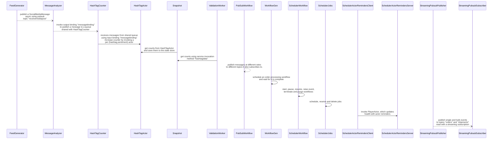

# Dapr Test Infra

This repo holds Dapr's long-haul, soak and reliability tests: apps that exercise Dapr building blocks, including workflows and the scheduler, around the clock on a long-running cluster.

The apps are deployed to the release long-haul cluster by the [`dapr-deploy.yml`](./.github/workflows/dapr-deploy.yml) workflow in this repo, and to the weekly long-haul cluster by the [`dapr-longhaul-weekly.yml`](https://github.com/dapr/dapr/blob/master/.github/workflows/dapr-longhaul-weekly.yml) workflow in dapr/dapr. Their metrics are shown on Grafana dashboards (see [Accessing the Grafana dashboards](#accessing-the-grafana-dashboards); the dashboard definitions are in [longhaul-test/dashboards](./longhaul-test/dashboards)).

Test apps for long haul tests:
* [Feed Generator](./feed-generator) : publishes random social media messages to the `receivemediapost` topic. Exercises the pubsub component (publishing).
* [Message Analyzer](./message-analyzer) : subscribes to `receivemediapost`, adds a sentiment to each message and sends it to the `messagebinding` output binding. Exercises pubsub component (subscribing) and output binding.
* [HashTag Counter](./hashtag-counter) : reads messages from the `messagebinding` input binding and increments a counter on a per (hashtag, sentiment) actor. Exercises input binding and actor component.
* [HashTag Actor](./hashtag-actor) : hashtag-actor logic, one actor per (hashtag, sentiment) pair that keeps a count in state. Exercises actor component.
* [Snapshot](./snapshot) : periodically reads every hashtag actor's count, saves the totals to the state store and serves them on `hashtagdata`. Exercises actor invocation and state.
* [Validation Worker](./validation-worker) : calls the snapshot app's `hashtagdata` method with service invocation every minute and reports a metric when the counts stop changing. Exercises service invocation.
* [Pubsub Workflow](./pubsub-workflow) : publishes to and subscribes to its own Azure Service Bus topics at four rates (every 10 seconds, 5 minutes, 1 hour and 12 hours). Exercises pubsub component (publishing and subscribing).
* [Workflow Gen](./workflow-gen) : every 30 seconds starts an order processing workflow (notify, reserve inventory, process payment, update inventory) and waits for it to complete. Exercises Dapr Workflow and state.
* [Scheduler Workflow](./scheduler-workflow) : starts workflows in a loop, pauses, resumes and raises an external event on each, then terminates and purges it. Exercises Dapr Workflow on the scheduler.
* [Scheduler Jobs](./scheduler-jobs) : continuously schedules one-shot, repeating and indefinite jobs, and creates and deletes jobs. Exercises the jobs API on the scheduler.
* [Scheduler Actor Reminders](./scheduler-actor-reminders) : a `PlayerActor` server and a client that drive its health with actor reminders. Exercises actor reminders stored in the scheduler.
* [Streaming Pubsub](./streaming-pubsub) : a publisher that sends single and bulk events to the `orders` and `shipments` topics, and a subscriber that reads them with streaming subscriptions. Exercises pubsub streaming subscriptions and bulk publishing.

Test analytics :
* [Test Crawler](./test-crawler) : A Python script scrapes the Dapr E2E tests results.

# Solution overview and app dependency



# Deploying this application

## Locally with Dapr Multi-App run

This is not properly a deployment, but it is a way to run all the longhaul applications locally using [Dapr Multi-App run](https://docs.dapr.io/developing-applications/local-development/multi-app-dapr-run/).


```bash	
# Start base components such as redis and zipkin, which we depend on
dapr init
# Start RabbitMQ which is used for our input/output binding tests.
docker run -d -p 5672:5672 --hostname dapr_rabbitmq --name dapr_rabbitmq rabbitmq:3-alpine
# Run all the apps
dapr run -f deploy/dapr-multi-app/dapr.yaml
```

## On Azure Kubernetes Service (AKS)

Define the resource group in which we will create the cluster and other resources and
the name of the cluster we will create.

```bash
export resourceGroup='myNewResourceGroup'
export location='eastus'
export clusterName='test-infra'
```

Create a resource group for your new cluster

```bash
az group create --name ${resourceGroup} --location ${location}
```

Deploy a cluster with test apps to this resource group:

```bash
az deployment group create --resource-group ${resourceGroup} --template-file ./deploy/aks/main.bicep --parameters "clusterName=${clusterName}"
```


Done! Explore your new AKS cluster with the sample applications

```bash
az aks get-credentials --admin --name ${clusterName} --resource-group ${resourceGroup}
```

### Regaining control of your AKS cluster's Dapr setup.


Our AKS Bicep templates offer a convenient way to quickly start up an
AKS cluster running our longhaul applications for E2E testing.
In this setup, Dapr is installed on the AKS cluster by means of an AKS extension.
Using this extension is great if you want a fully managed Dapr setup on your AKS cluster.
However, its use puts some constraints on the user's ability to control
the installed Dapr setup.
Using Helm or `dapr init -k` directly to manage, upgrade or uninstall Dapr on your AKS cluster won't work.

If you want to fully control Dapr setup on your cluster, you need to uninstall the extension first:

```bash
az k8s-extension delete --yes --resource-group ${resourceGroup} --cluster-name ${clusterName} --cluster-type managedClusters --name ${clusterName}-dapr-ext
```


Then you can re-install Dapr using Helm or `dapr init -k`:

```bash
export DAPR_VERSION_TO_INSTALL='1.19.0'
helm upgrade --install dapr dapr/dapr \
    --version=${DAPR_VERSION_TO_INSTALL} \
    --namespace dapr-system \
    --create-namespace \
    --wait
``` 

Don't forget to do a rolling restart in all apps to pick up the new manually-installed Dapr version: 😉

```bash
for app in "feed-generator-app" "hashtag-actor-app" "hashtag-counter-app" "message-analyzer-app" "pubsub-workflow-app" "snapshot-app" "validation-worker-app" "workflow-gen-app"; do
    kubectl rollout restart deploy/${app} -n longhaul-test || break
done 
```

### Accessing the Grafana dashboards
The Grafana dashboards run inside the AKS cluster. To open them, port-forward the Grafana service to your local machine.

The workflows deploy to the release cluster that the `LONGHAUL_RELEASE_CLUSTER` repository variable names. If the variable is not set, they use `aks-longhaul-release-119`. The resource group has the same name as the cluster.

```bash
az aks get-credentials --name aks-longhaul-release-119 --resource-group aks-longhaul-release-119
kubectl port-forward svc/grafana 8080:80 --namespace dapr-monitoring
```

The username for the Grafana dashboard is "admin" and you can get the password by running:
```bash
kubectl get secret --namespace dapr-monitoring grafana -o jsonpath={.data.admin-password} | base64 --decode
```

## On Azure Container Apps (ACA)

The [Container Apps template](./deploy/containerapps) deploys the feed generator, message analyzer, hashtag counter, hashtag actor, snapshot, validation worker and pubsub workflow apps. Create a resource group and deploy the template to it:

```bash
export LOCATION='<region_of_choice>'
export RESOURCE_GROUP='<resource_group_name>'

az group create -n $RESOURCE_GROUP -l $LOCATION
az deployment group create -g $RESOURCE_GROUP -f ./deploy/containerapps/main.bicep
```
